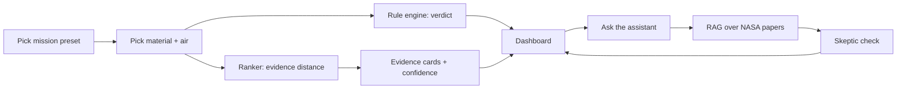

# 08 · Product plan

## 1. Lean Canvas
| Block | AstroFire |
|---|---|
| Problem | Fire-safety answers for space are scattered; Earth tests miss microgravity risk; Moon/Mars conditions almost untested |
| Segments | Mission/habitat engineers (primary) · safety reviewers · NASA researchers · educators (later) |
| UVP | Will it burn, what proves it, how sure are we — from NASA data, in minutes |
| Solution | Scenario risk check · hidden-risk list · evidence cards · gap map + next experiment · cited AI assistant |
| Channels | Space Apps showcase · open-source repo · agency/research partners **[assumption]** |
| Revenue | Free research tool now; later licences for commercial space stations/habitat builders **[assumption]** |
| Costs | LLM API calls, hosting, data curation time |
| Key metrics | Time to a cited answer · % answers with sources · gold-set accuracy |
| Unfair advantage | Evidence-distance confidence + skeptic check (honest AI) |

## 2. MVP scope (MoSCoW) — for Sat's demo
**Must**
1. Data library: 3–5 investigations (BASS-II first, then SAFFIRE, FLEX) in one schema (CSV/SQLite).
2. Scenario input: mission preset (ISS / Moon / Mars) + material + O₂ / pressure / airflow.
3. Risk verdict (rule-based, transparent) + ranked evidence cards with source links.
4. Confidence score from evidence distance; "low confidence" banner outside tested data.
5. AI assistant (RAG over 5–10 papers) that answers with citations.
6. Deployed public link.

**Should**
7. Hidden-risk list for the selected mission.
8. Gap map + next-experiment recommendation.
9. Skeptic check: answer blocked/flagged if a sentence has no source.

**Could**
10. Fan control advisor · FMEA + crew card · Arabic mode.

**Won't (this weekend)**
Hardware node · 3D simulation · user accounts · full PSI ingestion.

## 3. User stories (Must)
| Story | Acceptance criteria |
|---|---|
| As an engineer, I pick a mission and a material so that I see if it will burn | Verdict shown in < 2 s; shows O₂ margin vs limit |
| As an engineer, I see the experiments behind the verdict so that I can verify it | ≥ 3 evidence cards, each with source link (PSI or NTRS) |
| As an engineer, I see how sure the answer is so that I don't over-trust it | Confidence High/Medium/Low; Low when no test within range; banner says why |
| As a researcher, I ask a question in plain words so that I get a cited answer | Every sentence has a [source]; "no data" when nothing retrieved |
| As a judge, I open the link so that I can try it myself | Public URL works on phone and laptop, no login |

## 4. Simple PRD
**Goal:** Turn NASA microgravity fire experiments into cited, confidence-rated answers for a mission.
**Users:** mission engineers (primary), researchers.

**Screens:** Overview (verdict, map, evidence) · Watchlist (Should) · Gaps (Should) · Assistant panel.
**Data:** PSI experiment tables → one schema: `exp_id, investigation, fuel, gravity_g, o2_pct, pressure_kpa, flow_cm_s, result, source_url`. NTRS PDFs → chunks + embeddings.
**Integrations:** LLM API (team's choice), Chroma/FAISS, NTRS links.
**Out of scope:** real certification decisions; claims beyond tested data.

## 5. Tech stack (fast first)
| Layer | Choice | Fallback |
|---|---|---|
| Backend | Python, FastAPI, pandas, SQLite | Static JSON files |
| AI | LLM API + Chroma + LangChain/LlamaIndex | Pre-computed answers for 5 demo questions |
| UI | Existing FlameLedger dashboard HTML → wire to API; or Streamlit | Current static dashboard as is |
| Deploy | Render / Railway / Vercel / HF Spaces | GitHub Pages for the static UI |

## 6. KPIs
- **Demo:** cited answer in < 10 s; 100% of answers carry a source; ≥ 8/10 gold-set questions correct.
- **Future:** experiments covered; engineer time saved per question; gaps closed by new tests.

## 7. Impact and model
Safer crews, faster design decisions, better-targeted NASA research. Free/open for research; licensing for commercial habitat builders later **[assumption]**. SDG link: SDG 9 (industry, innovation, infrastructure).

## 8. Risks
| Risk | Type | Mitigation |
|---|---|---|
| PSI download/format fails | Technical | Start with 1 table; keep curated CSV of hand-entered rows |
| LLM invents a safety claim | Ethical/legal | Citations required; skeptic check; verdict from rules, not LLM |
| Model too simple for judges | Validity | Label as illustrative; show the cited BASS-II finding it reflects |
| Deploy breaks at submission | Technical | Deploy by Fri 20:00; keep a recorded backup video |
| Using NASA logos | Rules | No NASA logos or insignia anywhere |
| AI-generated images not disclosed | Rules | Label AI images/video; list tools (Claude, Gamma, Veo…) |
